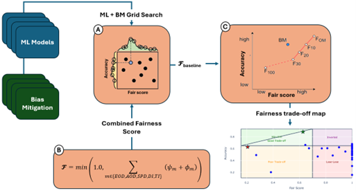

<div align="center">   
  
  
# FairHealthGrid: A Systematic Framework for Evaluating Bias Mitigation Strategies in Healthcare Machine Learning
</div>

<h3 align="center">
  <a href="https://aisel.aisnet.org/amcis2025/intelfuture/intelfuture/46/">Paper Link*</a> |
  <a href="">Slides (soon)</a>
</h3>

<br><br>


## Table of Contents:
1. [Overview](#overview)
2. [News](#news)
3. [Getting Started](#start)
4. [Results](#results)
5. [Citation](#citation)
6. [License](#license)
7. [Related Resources](#resources)

## Overview* <a name="overview"></a>
The integration of machine learning (ML) into healthcare demands rigorous fairness assurance to prevent algorithmic biases from exacerbating disparities in treatment. This study introduces FairHealthGrid, a systematic framework for evaluating bias mitigation strategies across healthcare ML models. Our framework combines grid search with a composite fairness score, incorporating fairness metrics weighted by risk tolerances. As output, we present a trade-off map concurrently evaluating accuracy and fairness, categorizing solutions (model + bias mitigation) into the following regions: Win-Win, Good, Poor, Inverted, or Lose-Lose. We apply the framework on three different healthcare datasets. Results reveal significant variability across different healthcare applications. The framework identifies model-bias mitigation for balancing equity and accuracy, yet highlights the absence of universal solutions. By enabling systematic trade-off analysis, FairHealthGrid allows healthcare stakeholders to audit, compare, and select ethically aligned ML models for specific healthcare applications—advancing towards equitable AI in healthcare.

## News <a name="news"></a>
**`2025/1/6`** Our paper got accepted on AMCIS 2025.

## Getting Started* <a name="start"></a>
To install and use FairHealthGrid, follow these steps:

Requires Python 3.11+. With [uv](https://docs.astral.sh/uv/):

```bash
uv venv --python 3.11 && source .venv/bin/activate
uv pip install "callmefair[dl]"
```

See the [documentation](https://callmefair.readthedocs.io/en/latest/) for installation details (macOS, CUDA), guides and the API reference.

Example notebooks (run in order) are in `examples/notebooks/`; raw data for reproducing their preprocessing is described in `examples/data/raw/README.md`.

## Results <a name="results"></a>

*The results below are taken from the paper.*

### Key Findings

Our evaluation across three healthcare datasets reveals that **preprocessing and in-processing strategies offer the best balance between fairness and accuracy**, while multi-stage bias mitigation approaches risk over-correction. The framework demonstrates significant variability in bias mitigation effectiveness across different healthcare applications, highlighting the absence of universal solutions.

### Main Contributions

We introduce **FairHealthGrid**, a comprehensive framework that addresses critical gaps in healthcare AI fairness evaluation:

1. **Systematic Evaluation Framework**: Exhaustive grid search optimization for model-strategy combinations in healthcare AI
2. **Unified Fairness Score (𝓕)**: Integrates five fairness metrics with risk tolerances for comprehensive bias assessment
3. **Interpretable Trade-off Maps**: Context-driven model selection through fairness-accuracy visualization

### Framework Benefits

- **Model-agnostic design** enabling evaluation across diverse ML architectures
- **Context-specific evaluations** prioritizing datasets with sensitive attributes
- **Actionable insights** for clinical deployment decisions
- **Systematic methodology** for selecting appropriate bias mitigation strategies

### Limitations & Future Work

Current evaluations focus on single protected attributes. Future research will address intersectional bias from interacting sensitive features, expand to new data modalities, and formalize a comprehensive bias taxonomy using causal fairness frameworks.




*Figure 1: Proposed approach consists of three main stages: (A) Grid Search, where multiple machine learning models (ML) and bias mitigation (BM) strategies are evaluated; (B) Computation of the Combined Fairness Score (𝓕), aggregating multiple fairness measures to quantify bias; and (C) Fairness Trade-off Mapping, which utilizes the baseline fairness score 𝓕baseline and naive mutation strategies (𝓕10–𝓕100) to generate a trade-off curve. The final trade-off map categorizes models into trade-off regions.*


## Citation <a name="citation"></a>

If you find our project useful for your research, please consider citing our paper and codebase with the following BibTeX:

```bibtex
@inproceedings{paiva2025fairhealthgrid,
  title     = {FairHealthGrid: A Systematic Framework for Evaluating Bias Mitigation Strategies in Healthcare Machine Learning},
  author    = {Paiva, Pedro and Dehghani, Farzaneh and Anzum, Fahim and Singhal, Mansi and Metwali, Ayah and Gavrilova, Marina and Bento, Mariana},
  booktitle = {31st Americas Conference on Information Systems (AMCIS 2025)},
  publisher = {Association for Information Systems},
  year      = {2025},
  url       = {https://aisel.aisnet.org/amcis2025/intelfuture/intelfuture/46/}
}
```

## License <a name="license"></a>
MIT; see [LICENSE](LICENSE).

## Related Resources <a name="resources"></a>
- [Related Literature](https://www.frontiersin.org/journals/computational-neuroscience/articles/10.3389/fncom.2024.1434421/full) (ai2lab)
- [Web Content](https://d2l.ai/)
